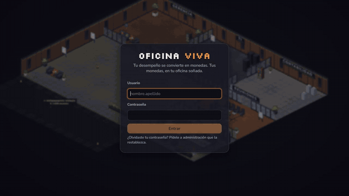
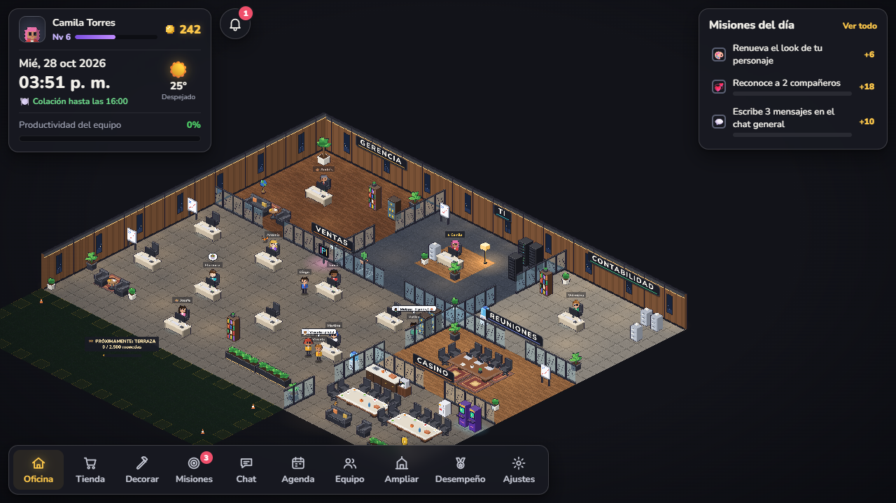
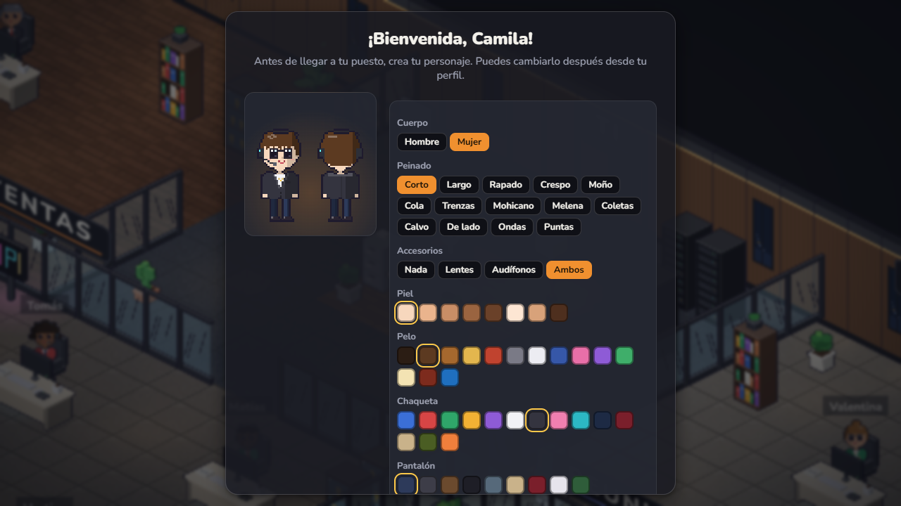
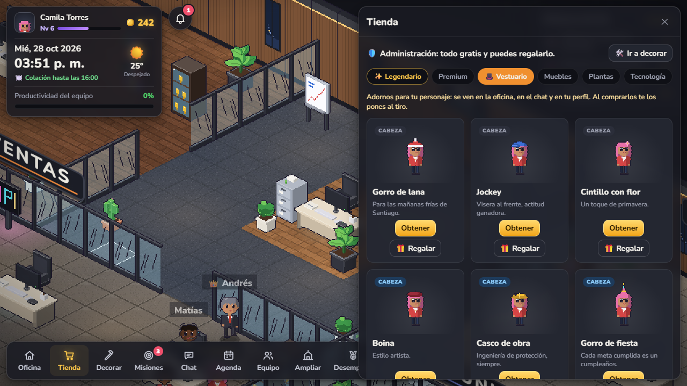
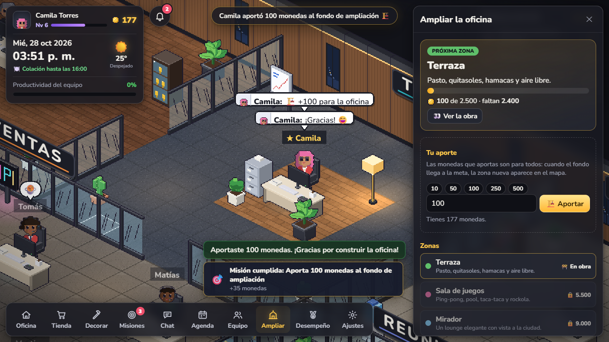

<div align="center">

# 🏢 Oficina Viva

**An isometric virtual office where performance turns into coins, and coins turn into the desk you've always wanted.**

Developed by [**danidev.cl**](https://danidev.cl)


[](https://github.com/sponsors/Dysast3r)



</div>

---

Oficina Viva is a small, self-hosted game for real teams. Everyone gets a pixel-art character and a desk in a shared isometric office. Good work, recognising teammates, showing up on time and joining meetings all earn coins. Those coins buy furniture, plants, floors and outfits, or go into a common fund that physically grows the office.

It runs as a single Node process with an embedded SQLite database, so one `docker compose up` is enough to host it for a team.

> **Language note:** the in-game interface is in Spanish, and so are the code comments. The game clock and the live weather follow Santiago, Chile (`America/Santiago`).

## Contents

- [Features](#features)
- [Screenshots](#screenshots)
- [Quick start (Docker)](#quick-start-docker)
- [Local development](#local-development)
- [Configuration](#configuration)
- [Roles](#roles)
- [Working hours](#working-hours)
- [Architecture](#architecture)
- [Operations](#operations)
- [Support the project](#support-the-project)

## Features

### 🪙 Coins and progression
- **Ways to earn:** performance logged by managers, **3 daily missions** plus weekly missions, achievements with rewards (some unlock exclusive outfits), a daily chest, on-time check-in, streaks, level-up bonuses, a daily team goal and meeting attendance.
- **Levels and XP**, with a coin bonus at every level.
- Everything is spelled out in-game under *Misiones → Cómo ganar monedas*.

### 🛋️ Decorate your space
- **Shop:** 60+ items across furniture, plants, tech, decor, premium and legendary tiers (disco ball, golden throne, rocket, T-Rex skeleton…), plus floors.
- **Decorate mode:** place items on your own desk or in any common room except management. Placement can't block doors, other people's desks or walkways.
- **Living details:** plants sway, shed leaves and pollen, and attract butterflies.

### 🧑‍🎨 Characters
- 14 hairstyles, plus skin, hair, jacket and trouser colours and accessories.
- **Wardrobe:** hats, glasses, beard, bow tie, crown, halo and more. You can try each one on your own character before buying it.
- **Gestures:** characters stretch when they stand up, drink coffee in the cafeteria, take phone calls, wave when they pass each other and chat when they visit someone.

### 💬 Social
- **Chat:** a general channel, where each message also appears as a speech bubble over the sender's character, and private messages with unread counters.
- **Recognition:** send kudos to teammates; giving and receiving them counts towards missions and achievements.
- **Notifications:** a bell with history, plus live toasts for gifts, kudos, achievements, missions, meetings and the team goal.
- **Announcements:** admins post them from *Agenda → Avisos* and they appear on everyone's screen.

### 🗓️ Meetings
Managers and admins schedule meetings from the agenda. At start time, or when someone presses *Iniciar ahora*, every invited character **walks to the meeting room** and stays there until the meeting ends. Attending earns coins.

### 🏗️ The office grows
Everyone can put coins into a shared fund. Each milestone unlocks a new area, and until then you can watch it as a construction site with its progress:

| Area | Goal | What's inside |
|---|---|---|
| Terrace | 2,500 | Grass, sun umbrellas, hammocks, fresh air |
| Game room | 5,500 | Ping-pong, pool, foosball, jukebox |
| Lookout lounge | 9,000 | An elegant lounge with a city view |

### 🌦️ A world that feels alive
- **Real time and weather:** the clock uses Chilean time and the sky shows the actual weather (from [Open-Meteo](https://open-meteo.com/), refreshed every 10 minutes, no API key needed).
- **Lighting follows the sun:** dawn, golden hour, sunset and night. Rain, snow and storms show up inside the office too.
- **Office pets:** Bruno (a golden retriever) and Mandarina (an orange cat) wander around, curl up next to people, beg for food at lunch and sleep at night. Click them to pet them.
- **A daily routine:** people work at their desks, take short walks, have lunch together in the cafeteria and go quiet after hours.

## Screenshots

| | |
|---|---|
|  |  |
| **The whole office**, zoomed out | **Character creation** on first login |
|  |  |
| **Shop**: wardrobe items you try on first | **Expansion fund**: contributing to the next area |

## Quick start (Docker)

```bash
git clone https://github.com/Dysast3r/oficina-viva.git
cd oficina-viva
docker compose up -d --build
```

Open **http://localhost:4480**.

On first start the server creates the sample team with **temporary passwords** and prints them to the log:

```bash
docker compose logs app
```

They are also saved to `/data/credenciales-iniciales.txt` inside the volume. Each person must choose their own password the first time they log in.

> The starting team in [`src/data/seed.ts`](src/data/seed.ts) is fictional. Replace it with your own people **before** the database is created. After that, manage accounts from the in-game **Ajustes** (settings) panel.

## Local development

Requires **Node 22.13 or newer**, because it uses the built-in `node:sqlite`.

```bash
npm install
npm run dev     # server + Vite with hot reload → http://localhost:4460
npm run build   # type-checks client and server, then builds the frontend
npm start       # production mode (run `npm run build` first)
```

In development the database lives at `server/data/oficina-viva.db`, which git ignores.

## Configuration

| Variable | Default | Description |
|---|---|---|
| `PORT` | `4460` | Port the server listens on. |
| `HOST` | `localhost` | Bind address. The Docker image uses `0.0.0.0`. |
| `DB_PATH` | `server/data/oficina-viva.db` | SQLite file location. The Docker image uses `/data/oficina-viva.db`. |
| `PUBLIC_URL` | `http://<host>:<port>` | URL shown in the startup log. |
| `TRUST_PROXY` | *(unset)* | Set to `1` behind an HTTPS reverse proxy, so session cookies are marked `Secure` and login rate limiting sees the real client IP. |
| `NODE_ENV` | — | `production` serves the compiled frontend instead of Vite. You can also pass `--prod`. |
| `APP_PORT` | `4480` | Docker Compose only: the host port mapped to the container. |

## Roles

| Role | Can do |
|---|---|
| **Collaborator** | Decorate their desk, earn coins, recognise teammates. |
| **Manager** (*Jefatura*) | Everything above, plus log performance for their own area. |
| **Executive** (*Gerencia*) | Log performance for the whole team. |
| **Admin** (*Administración*) | Get every item free with no level requirement, gift items to anyone (the recipient gets notified), post announcements and open **Ajustes**. |

From **Ajustes**, admins can add people (this generates a username and a temporary password), edit name, title, role and username, reset passwords and deactivate accounts.

## Working hours

Defined in [`src/data/schedule.ts`](src/data/schedule.ts), Chilean time:

- **Monday to Thursday** 8:30–18:00, **Friday** 8:30–16:45.
- Check-in opens 30 minutes before the start of the day and stays open until the end of the day.
- Streaks only count working days, so weekends don't break them. Weekends have no missions or daily bonus.
- During working hours, everyone sits at their desk and takes one short 10–15 minute walk per hour. Walks are spread out so the office never empties at once.
- **Lunch from 15:00 to 16:00:** everyone heads to the cafeteria, then back to their desks.

## Architecture

```
src/
  data/          shared game rules (client + server)
    logic.ts       missions, achievements, meetings, announcements, expansion fund
    progress.ts    mission pools, achievements and rewards
    catalog.ts     shop items, floors, wardrobe, levels
    layout.ts      floor plan and expansion areas
    schedule.ts    working hours and time zone
    store.ts       optimistic client store: applies actions instantly, server confirms or rolls back
    social.ts      chat, notifications, presence
  game/          Phaser 4 scene: isometric rendering, pathfinding, procedural pixel art
  ui/            React 19 HUD and panels
server/          Express 5 + node:sqlite
```

- **One set of rules everywhere:** game logic lives in `src/data` and runs on both the client and the server. The UI reacts instantly, and the server stays authoritative.
- **Live updates** use Server-Sent Events, so every change reaches the whole team immediately.
- **Auth:** scrypt-hashed passwords, `httpOnly` session cookies, forced password change on first login and rate-limited login attempts.
- **Privacy:** notifications and private messages live in their own tables, and each person only receives their own.
- **Procedural art:** characters, furniture and textures are painted in code at startup. There are no sprite sheets to manage.

## Operations

| Task | Command |
|---|---|
| Stop (data is kept in the `oficina-viva-data` volume) | `docker compose down` |
| Update after code changes | `docker compose up -d --build` |
| Back up the database | `docker compose cp app:/data/oficina-viva.db ./backup.db` |
| Wipe everything and start over | `docker compose down -v` |
| Other machines on your network | `http://<host-ip>:4480` |

**Reset progress.** This puts everyone back at level 1, except admins, and keeps accounts and characters. Back up first.

```bash
docker compose stop app
docker compose run --rm --no-deps app node --import tsx server/reset-progress.ts
docker compose start app
```

In development, stop the server and run `npm run reset-progress`.

## Support the project

If Oficina Viva brightens your team's day, or you'd like to see more features, you can support its development on GitHub Sponsors. Every contribution helps keep the project alive and growing.

<a href="https://github.com/sponsors/Dysast3r"></a>

A ⭐ on the repo also helps more people find it.

---

<div align="center">

Developed with ❤️ by **[danidev.cl](https://danidev.cl)**

</div>
